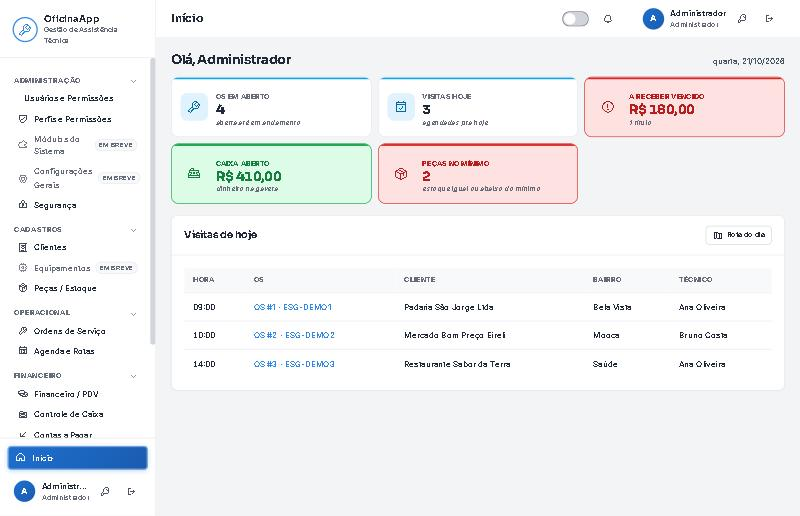
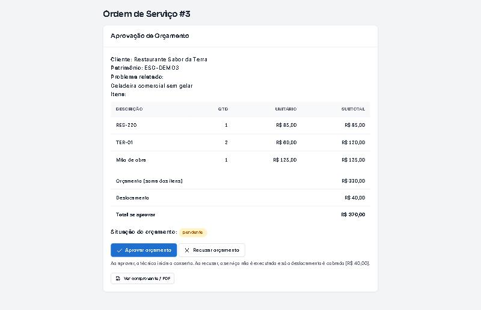
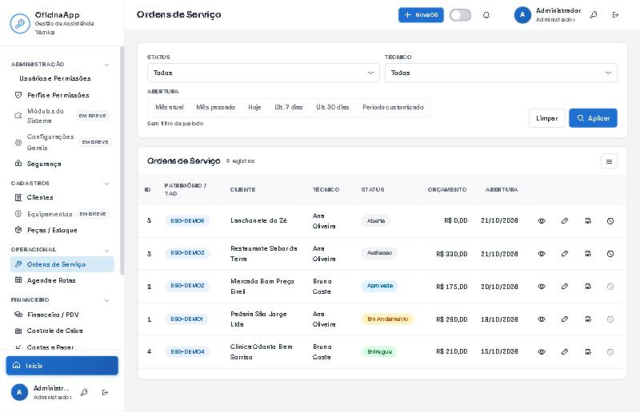
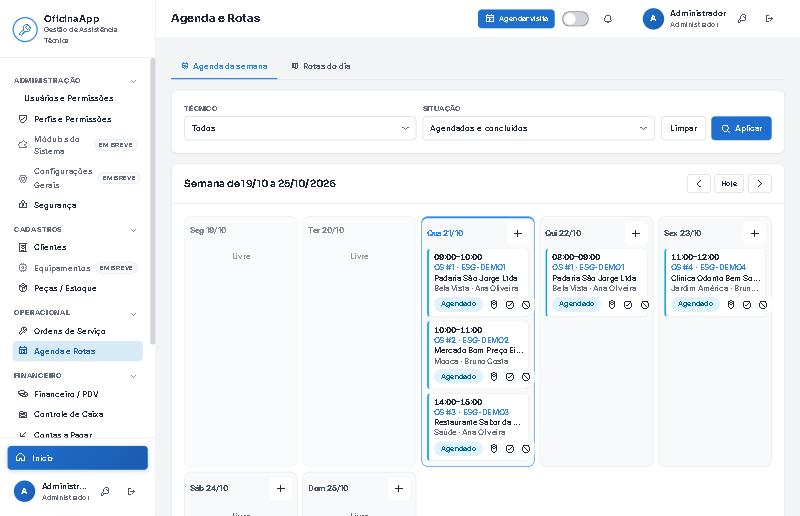
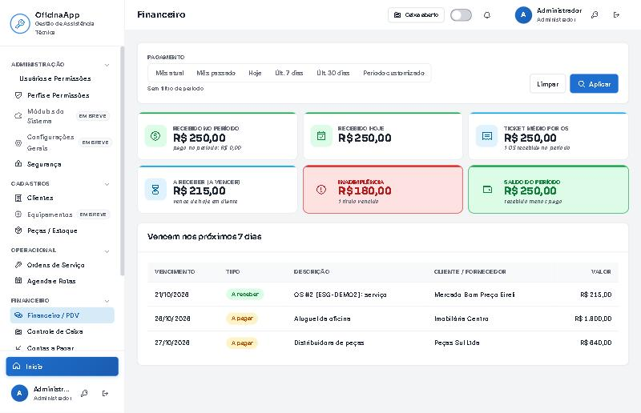
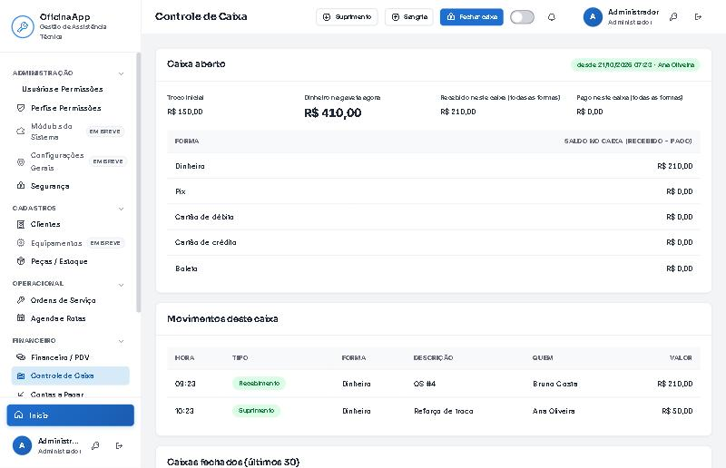
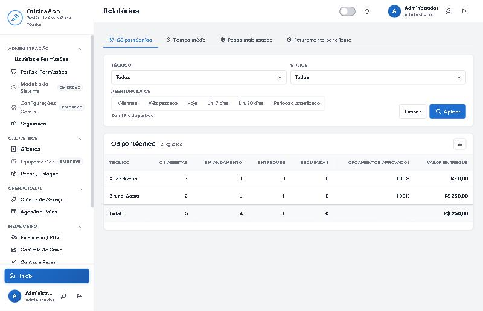
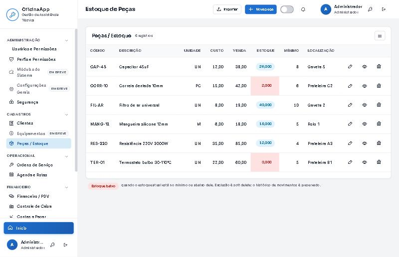
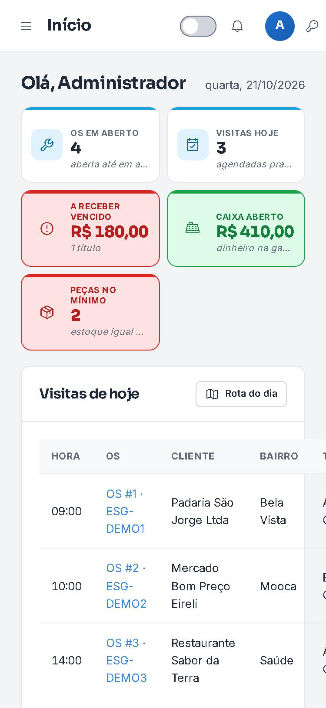

<div align="center">

# 🔧 OficinaApp

**Sistema de gestão para assistências técnicas e oficinas**

Ordens de serviço com aprovação do cliente por link, agenda e rotas, financeiro com PDV,
relatórios e um app que instala no celular — tudo num sistema só.


</div>

---

## O que o sistema faz

Uma oficina cuida de clientes, equipamentos, peças, ordens de serviço, agenda, caixa e
cobrança — hoje quase sempre espalhado em cadernos, planilhas e no WhatsApp. O **OficinaApp**
junta tudo num fluxo só, do orçamento à entrega assinada pelo cliente.

### 🧰 Ordens de serviço, do começo ao fim
- Cada OS nasce com uma **tag de patrimônio** própria e aceita **foto do antes e do depois**.
- O orçamento é a **soma dos itens** (peças + mão de obra + deslocamento).
- O cliente **aprova ou recusa por um link, sem precisar de senha**, e **assina a entrega na tela**.
- Recusou? Cobra só o deslocamento. Entregou? A peça baixa do estoque e a conta a receber nasce sozinha.
- **Comprovante em PDF** pela tela de impressão, enviado pelo WhatsApp.

### 👥 Cadastros
- **Clientes e equipamentos** com foto e histórico.
- **Peças / estoque** com alerta de estoque mínimo, entrada e saída, e **importação por planilha Excel** (modelo pronto, com prévia antes de gravar).

### 🗓️ Agenda e rotas
- **Agenda semanal por técnico**: clicar já atribui a OS a quem vai atender.
- **Rota do dia** agrupada por bairro, com link direto pro mapa.

### 💰 Financeiro + PDV
- **Caixa**: abertura, sangria, suprimento e fechamento conferindo o dinheiro contado.
- **Contas a pagar e a receber** com filtro, baixa por forma de pagamento, parcelamento e **recibo**.

### 📊 Painéis e relatórios
- **Início** com os números do dia (OS em aberto, visitas, vencidos, caixa, peças no mínimo).
- **Relatórios**: OS por técnico, tempo médio, peças mais usadas e faturamento por cliente — tudo **exportável em CSV/Excel**.

### 📱 Instala no celular (PWA)
- O técnico instala como app no celular e abre a agenda na rua; funciona com uma tela de aviso quando cai a internet.

### 🔒 Feito com segurança a sério
Login com bloqueio de força bruta, CSRF em todo formulário, cabeçalhos de segurança, controle de
sessão por inatividade, proteção contra acesso indevido a dados de outro técnico (IDOR), validação
de upload por conteúdo real do arquivo, três perfis de acesso (administrador, técnico e cliente via
link) com permissões por módulo, log estruturado e uma tela para o administrador ajustar os
parâmetros de segurança sem reinstalar nada.

---

## 👤 Perfis de acesso

| Perfil | O que faz |
|---|---|
| **Administrador** | Tudo: cadastros, financeiro, relatórios, usuários e permissões. |
| **Técnico** | Suas OS, fotos, peças, agenda e rotas — vê só o que é dele. |
| **Cliente** | Sem login: aprova o orçamento e assina a entrega pelo link que recebe. |

---

## 🛠️ Como é feito

- **Backend:** Python 3.12 + Flask, banco **SQLite** (um arquivo só, fácil de copiar e versionar).
- **Frontend:** HTML/CSS/JS próprios, sem framework pesado; ícones Phosphor e fontes self-hosted.
- **Produção:** imagem **Docker** com **gunicorn** (ver `MIGRACAO.md`).
- **Qualidade:** **529 casos de teste automatizados** cobrindo o fluxo de ponta a ponta e o bloco de segurança.

---

## ▶️ Rodar no computador (uso local)

Precisa do **Python 3.12** instalado (em [python.org](https://www.python.org/downloads/), marcando "Add Python to PATH").

```bash
# Windows: dois cliques em iniciar.bat
# ou, no terminal, dentro da pasta do projeto:
python -m venv .venv
.venv\Scripts\activate
pip install -r requirements.txt
python scripts\preparar_env.py   # gera a chave e pergunta o e-mail do admin
python app.py
```

Abra **http://127.0.0.1:5000** e entre com o e-mail do administrador e a senha que aparece no console
na primeira vez. O passo a passo completo está em **[`LEIA-ME.txt`](LEIA-ME.txt)**.

> Para usar no celular do técnico e no link do cliente, o sistema precisa ir para um servidor com
> `https://`. O caminho está em **[`MIGRACAO.md`](MIGRACAO.md)**.

---

## 📂 Organização

```
OficinaApp/
├── app.py                 # ponto de entrada
├── core/                  # banco, auth, segurança, PWA, log, formatação
├── modules/               # os, clientes, estoque, agenda, financeiro, relatórios, admin...
├── templates/             # telas (Jinja2)
├── static/                # css, js, fontes, ícones
├── scripts/               # schema, seed, testes e utilitários
├── Dockerfile             # imagem de produção (gunicorn)
├── iniciar.bat            # lançador de duplo clique (Windows)
├── LEIA-ME.txt            # guia de instalação local
└── MIGRACAO.md            # guia de publicação em servidor
```

---

## 📸 Telas

### Início — os números do dia num olhar


### O cliente aprova o orçamento por um link, sem senha


### Ordens de serviço


### Agenda da semana por técnico


### Financeiro com PDV e indicadores


### Controle de caixa


### Relatórios exportáveis


### Estoque com alerta de mínimo e importação por planilha


### Instala no celular (PWA)



---

## © Uso

Projeto desenvolvido para **ESG Serviços Técnicos**. Este repositório é de **divulgação**:
o código é apresentado como portfólio do sistema. Todos os direitos reservados — fale com o autor
antes de reutilizar.
